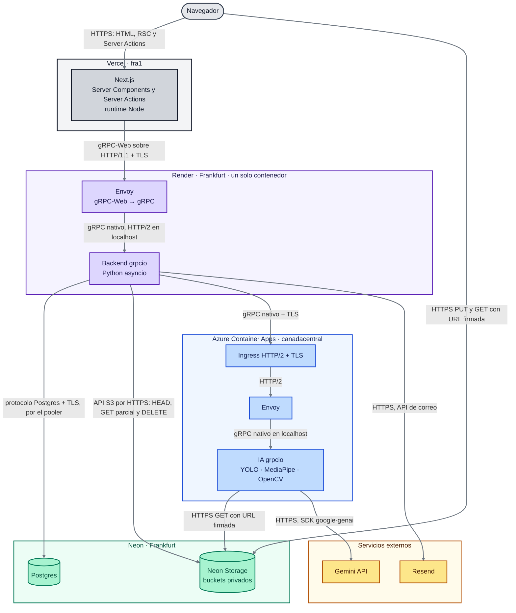
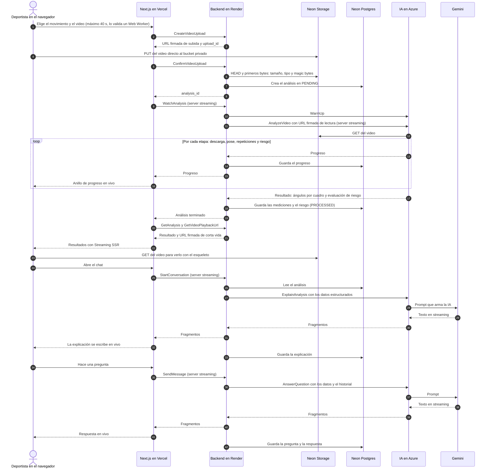
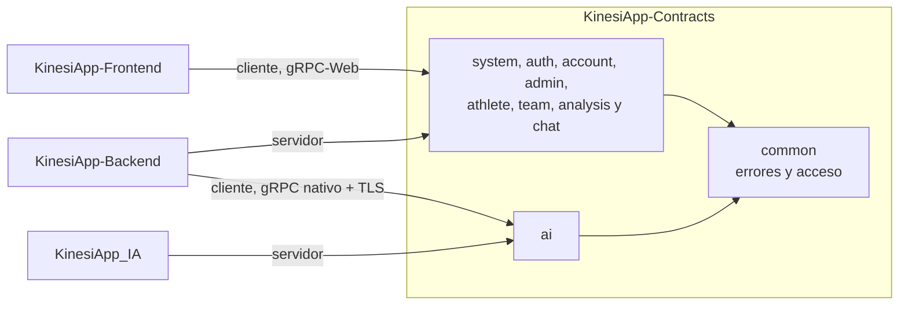
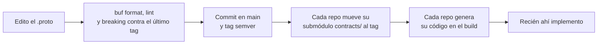

# KinesiApp Contracts

La app que usa estos contratos está publicada en **https://www.kinesiapp.com**.

Este repositorio es la única fuente de verdad de los contratos de KinesiApp. Aquí defino en Protobuf todos los servicios y mensajes con los que se comunican el frontend, el backend y el servicio de IA.

Trabajo contract-first: primero diseño el `.proto`, después cada repo genera su código a partir de él y solo entonces implemento. Si un RPC no está aquí, no existe.

## Requisitos

- **buf 1.74**, para formatear, hacer lint y detectar cambios incompatibles. Es la misma versión que instala el frontend con `npm install` (`@bufbuild/buf`), así que puedo usar `../KinesiApp-Frontend/node_modules/.bin/buf` sin instalarlo aparte.
- **Git**, para los tags semver que fijan los demás repos.
- No hace falta Node, Python ni Docker: aquí no se genera ni se corre código. Cada repo genera el suyo.

## Cómo está organizado

- `proto/kinesiapp/<dominio>/v<N>/`: un paquete versionado por dominio (`kinesiapp.system.v1`, `kinesiapp.auth.v1`, `kinesiapp.analysis.v1`, `kinesiapp.ai.v1`...).
- Uso [Buf](https://buf.build) para el lint y para detectar cambios incompatibles antes de publicar.
- Cada release es un tag semver (`v0.1.0`, `v0.2.0`...).

## Arquitectura de KinesiApp

KinesiApp son cuatro repos que se hablan solo por RPC definidos en [KinesiApp-Contracts](https://github.com/solartedaniers/KinesiApp-Contracts), sin API REST. Este diagrama y el de secuencia son los mismos en los cuatro README; cada flecha dice su protocolo.



### Flujo principal: subir un video, analizarlo, ver el resultado y preguntar al chat



### Qué hace cada parte

- **Navegador.** Ahí la persona graba o elige el video. Valido la duración en un Web Worker y subo el archivo directo al bucket con una URL firmada, así el video nunca pasa por Vercel. El navegador no habla gRPC ni conoce la URL del backend.
- **Next.js en Vercel.** Sirve las páginas con el patrón que le toca a cada una (SSG, ISR, SSR con streaming y CSR) y, desde los Server Components y las Server Actions, llama al backend con un cliente gRPC-Web generado del contrato. Guarda la sesión en cookies `httpOnly`.
- **Envoy en Render.** Render solo acepta HTTP/1.1 desde internet, así que Envoy recibe gRPC-Web y lo traduce a gRPC nativo hacia grpcio, en el mismo contenedor. Solo deja pasar las rutas del contrato.
- **Backend grpcio en Render.** Es el dueño de los datos y de las reglas: cuentas, roles, deportistas, equipos, análisis y chat. Verifica el token en un interceptor, guarda en Postgres, firma las URLs de los archivos y le encarga el trabajo pesado a la IA.
- **IA en Azure Container Apps.** Es un microservicio gRPC propio. Analiza el video con YOLO, MediaPipe y OpenCV y devuelve en streaming el progreso, los ángulos y el riesgo. También arma el prompt del chat y habla con Gemini. Baja a cero réplicas cuando nadie la usa, por eso el backend la despierta con `WarmUp`.
- **Neon Postgres.** Guarda las cuentas, los perfiles, los equipos, los análisis con sus mediciones y los mensajes del chat. Está en Frankfurt, junto al backend, para que cada consulta tarde poco.
- **Neon Storage.** Son buckets privados compatibles con S3 para los videos, las fotos y los logos. Solo se entra con URLs firmadas de corta vida.
- **Gemini.** Es el modelo de lenguaje que redacta la explicación del análisis y responde las preguntas. Solo lo llama la IA.
- **Resend.** Envía desde `no-reply@kinesiapp.com` los correos con el código de verificación y el de recuperación de contraseña.

## Arquitectura de este repo

Qué paquete implementa y consume cada repo:



Cómo viaja un cambio desde aquí hasta los demás repos:



## Dominios

| Paquete | Servicios | Quién lo llama |
|---|---|---|
| `kinesiapp.common.v1` | Solo tipos compartidos | Todos |
| `kinesiapp.system.v1` | `SystemService` | Frontend → backend |
| `kinesiapp.auth.v1` | `AuthService` | Frontend → backend |
| `kinesiapp.account.v1` | `AccountService` | Frontend → backend |
| `kinesiapp.admin.v1` | `UserAdminService` | Frontend → backend |
| `kinesiapp.athlete.v1` | `AthleteProfileService`, `ManagedAthleteService` | Frontend → backend |
| `kinesiapp.team.v1` | `TeamService` | Frontend → backend |
| `kinesiapp.analysis.v1` | `AnalysisService` | Frontend → backend |
| `kinesiapp.chat.v1` | `ChatService` | Frontend → backend |
| `kinesiapp.ai.v1` | `MovementAnalysisService`, `AssistantService`, `AiLifecycleService` | Backend → IA (gRPC nativo con TLS; gRPC-Web de respaldo; con secreto compartido) |

Un dominio nunca importa mensajes de otro; solo de `common`. Así cualquiera puede desplegarse aparte.

## Convenciones

- **Errores**: status code estándar de gRPC más un `google.rpc.ErrorInfo` en los detalles, con `domain = "kinesiapp"` y `reason` igual al nombre del valor de `kinesiapp.common.v1.ErrorReason` sin el prefijo (`EMAIL_ALREADY_REGISTERED`).
- **Acceso**: cada RPC declara quién puede llamarlo con la opción `(kinesiapp.common.v1.access)`. Sin la opción, exige sesión con cualquier rol. El token viaja en la metadata `authorization: Bearer <token>`.
- **Streaming**: solo server streaming, porque gRPC-Web no admite client ni bidi streaming. Lo uso en el progreso del análisis y en las respuestas del chat.
- **Archivos**: nunca viajan en un mensaje. Un RPC entrega una URL firmada de Neon Storage, el navegador sube directo al bucket y otro RPC confirma la subida.
- **Salud**: el estándar `grpc.health.v1.Health`, que no se define aquí, más `AiLifecycleService.WarmUp` en la IA.

## Cómo lo consumen los demás repos

Cada repo (`KinesiApp-Backend`, `KinesiApp-Frontend`, `KinesiApp_IA`) agrega este repositorio como submódulo git en `contracts/`, fijado a un tag. El código generado se produce en el build de cada repo y nunca se versiona ni se edita a mano.

```sh
git submodule add https://github.com/solartedaniers/KinesiApp-Contracts.git contracts
git -C contracts checkout v0.11.0
```

Para subir de versión, cada repo mueve el submódulo al tag nuevo y regenera:

- el backend y la IA con `python scripts/generate_grpc.py`;
- el frontend con `npm run generate`.

## Cómo publico un cambio

1. Edito el `.proto` y lo reviso con Buf desde la raíz:
   ```sh
   buf format -d          # sin diferencias
   buf lint
   buf breaking --against ".git#tag=v0.11.0"   # contra el último tag publicado
   ```
2. Solo agrego campos, mensajes o RPC. No renumero ni borro campos, para que los clientes viejos sigan funcionando. Si algo deja de usarse, lo marco `reserved`.
3. Hago commit, creo el tag semver siguiente y lo subo (hoy el último es `v0.11.0`, así que el siguiente sería `git tag v0.12.0 && git push origin v0.12.0`). Este es el único repo donde trabajo directo en `main`.
4. Solo después implemento el cambio en el backend, la IA o el frontend.

## Errores comunes

| Lo que veo | Por qué pasa | Cómo lo arreglo |
|---|---|---|
| `buf format -d` muestra diferencias | El `.proto` no tiene el formato de Buf. | `buf format -w` lo reescribe y vuelvo a revisar. |
| `buf lint` falla por nombres | Un RPC, mensaje o campo no sigue el estilo STANDARD, por ejemplo un request sin el sufijo `Request`. | Renombro como dice el error. Si ya está publicado, agrego uno nuevo en vez de renombrar. |
| `buf breaking` falla | Borré, renumeré o cambié el tipo de un campo publicado. | Lo deshago. Si el campo ya no sirve, lo marco `reserved` y agrego uno nuevo con otro número. |
| `buf breaking` dice que no encuentra el tag | No tengo los tags en local. | `git fetch --tags`. |
| Otro repo no ve el RPC nuevo | Su submódulo sigue en el tag anterior, o no regeneró. | En ese repo: `git -C contracts fetch --tags && git -C contracts checkout vX.Y.Z` y regenero. |
| El tag no aparece en GitHub | Lo creé pero no lo subí. | `git push origin vX.Y.Z`. |

## Flujo de trabajo

- **Aquí trabajo directo en `main`**, porque el repo nació vacío para esto. Cada cambio publicado es un tag semver nuevo.
- **Los demás repos trabajan en ramas feature** (`feature/grpc-backend`, `feature/grpc-ai`, `feature/grpc-frontend`) y fusionan a `main` con `--no-ff`.
- **El push a `main` de esos repos despliega a producción:** Render reconstruye el backend y Vercel el frontend.
- **La IA necesita el `az containerapp update`.** Su push solo construye la imagen en GHCR, y Azure la toma cuando corro `az containerapp update -n kinesiapp-ia -g kinesiapp-rg --image ghcr.io/solartedaniers/kinesiapp-ai:<sha>`.
- **Las migraciones se corren a mano** desde el backend con Alembic. Un cambio de contrato que necesite una columna nueva va primero a la base y después al código.
- **Las previews usan la base real.** Los previews del frontend hablan con el backend de producción, así que un contrato nuevo tiene que estar desplegado en el backend antes de probarlo en un preview.

## Producción

| Servicio | Dónde corre | Qué contrato implementa |
|---|---|---|
| Frontend (Next.js) | Vercel, con las funciones en `fra1` (Fráncfort): https://www.kinesiapp.com | Cliente de todos los paquetes de frontend → backend |
| Backend (Envoy + `grpcio`) | Render en Frankfurt, como servicio Docker | `system`, `auth`, `account`, `admin`, `athlete`, `team`, `analysis` y `chat`; cliente de `ai` |
| IA (Envoy + `grpcio`) | Azure Container Apps en `canadacentral`, con 0 a 1 réplica | `kinesiapp.ai.v1` |
| Base de datos | Neon Postgres en Frankfurt | — |
| Archivos | Neon Storage, buckets privados con URLs firmadas | — |

Los tres repos de producción están fijados hoy a `v0.11.0`.
